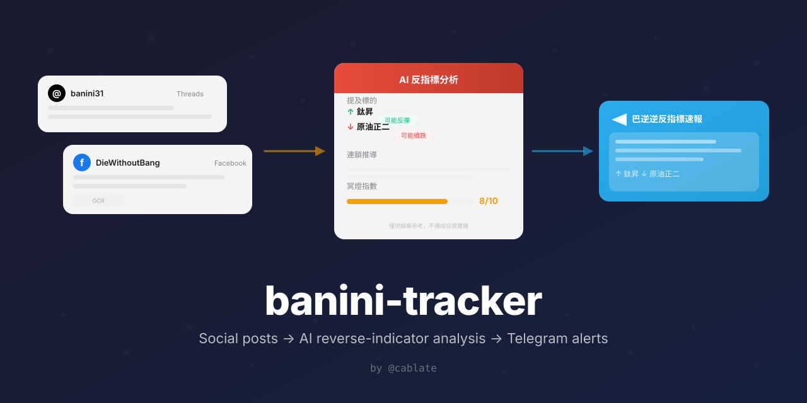
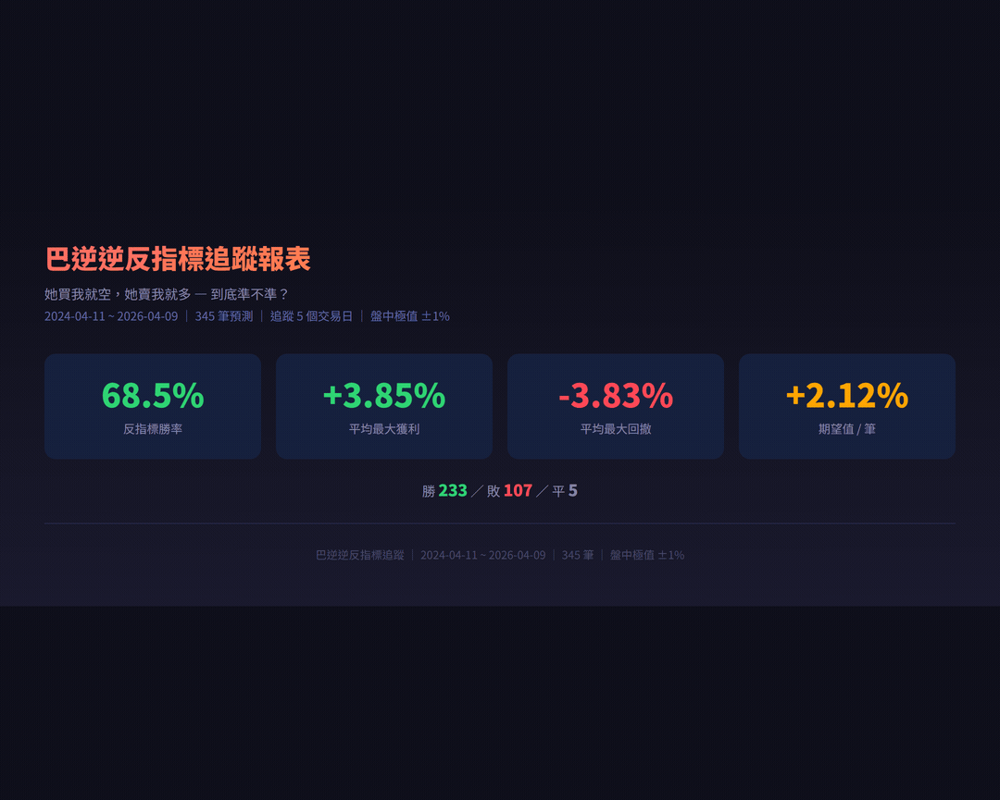
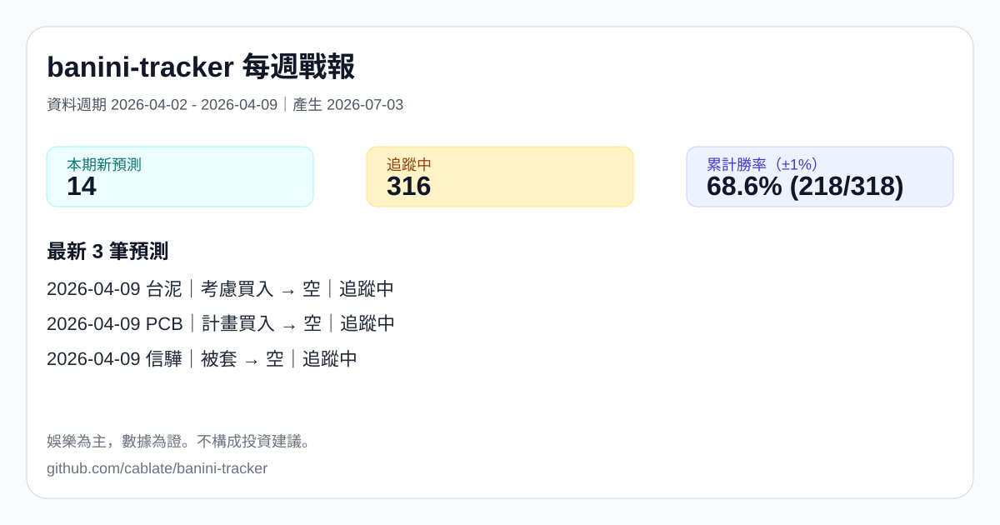
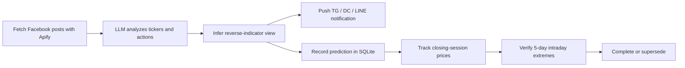
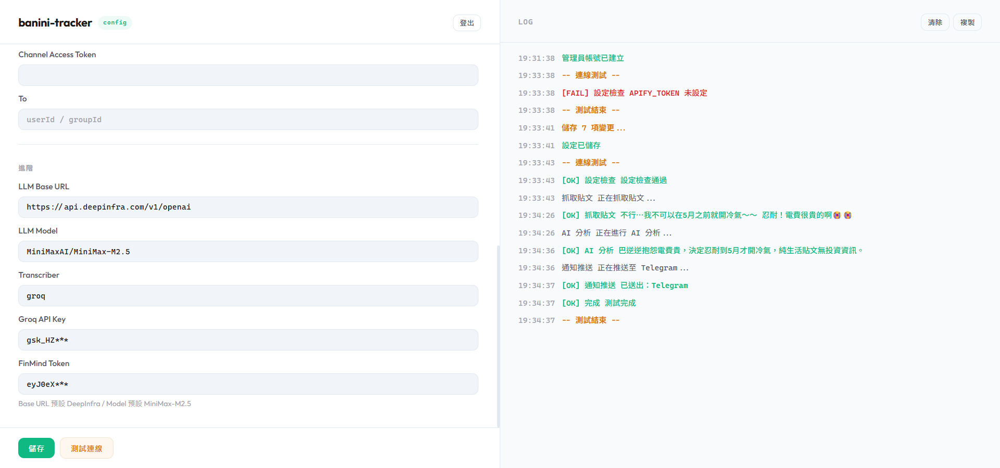

<p align="center">
  
</p>

<p align="center">
  <a href="README.md">繁體中文</a> | English
</p>

<h1 align="center">banini-tracker</h1>

<p align="center">
  <strong>Track a famous "reverse indicator" from Taiwan's stock community — AI-analyzed, auto-pushed, and back-tested against real market prices. Think <em>Inverse Cramer</em>, but with receipts.</strong>
</p>

<p align="center">
  <a href="https://www.npmjs.com/package/@cablate/banini-tracker"></a>
  <a href="https://github.com/cablate/banini-tracker/actions/workflows/ci.yml"></a>
  <a href="LICENSE"></a>
</p>

People call trades in social communities every day, but almost nobody checks whether doing the opposite actually works. banini-tracker follows Facebook posts from Banini / 8zz, identifies investment calls with AI, then verifies the reverse-indicator result against real market prices.

Using Claude Opus 4.6, the project back-tested 2,249 posts from 2024/04-2026/04 and extracted 345 clear investment predictions.

<p align="center">
  <strong>Reverse-indicator win rate: 68.6% (±1% threshold within 5 trading days, 318 valid samples)</strong>
</p>

<p align="center">
  
</p>

<p align="center">
  
</p>

## What It Does

1. Reads Banini's posts.
2. Uses AI to identify tickers, her action, and confidence.
3. Infers the reverse-indicator view.
4. Pushes updates to Telegram / Discord / LINE.
5. Tracks intraday high/low prices for 5 trading days and writes results to SQLite.

Push messages use plain text fields aligned with the current analysis output: `symbolName`, `herAction`, `reverseView`, `confidence`, and `reasoning`.

> Symbol: TSMC (2330)
>
> Her action: stop-loss sell
>
> Reverse view: possible rebound [high]
>
> Reasoning: a stop-loss sell can mark a sentiment low, so it enters 5-day tracking.

<!-- TODO: tg-report screenshot -->

## Quick Start

Try the public dataset and back-test summary with no keys:

```bash
npx @cablate/banini-tracker demo
```

| Option | Command / Entry | Best For |
|---|---|---|
| Zeabur | [](https://zeabur.com/templates/ITT41M) | Cloud deployment. Create the admin account in the Web UI on first launch |
| Docker | `docker build -t banini-tracker .`<br>`docker run -d --name banini --env-file .env -v banini-data:/data -p 3000:3000 banini-tracker` | Self-hosted service |
| npx serve | `npx @cablate/banini-tracker serve`<br>`npx @cablate/banini-tracker serve --port 8080` | Local scheduler + Web UI |
| Local development | `cp .env.example .env`<br>`npm install && npm run start` | Source changes |

## How It Works



| Schedule | Time | Description |
|------|------|------|
| Morning catch-up | Daily 08:00 | Fetch previous-night posts (3 posts) |
| Market hours | Mon-Fri 09:07-13:07 every 30 min | Real-time tracking (1 post) |
| Tracking update | Mon-Fri 15:00 | Update prediction tracking after market close |
| After hours | Daily 23:03 | Daily summary (3 posts) |

## Claude Code Skill

If you do not want to wire an LLM API, add [`skill/SKILL.md`](skill/SKILL.md) to your `.claude/skills/`. Claude Code can act as the analysis engine and produce reports that the CLI can push, without extra LLM cost.

## Methodology And Transparency

Public dataset: [`data/banini-public.db`](data/banini-public.db), SQLite format, with no original post bodies.

Schema summary:

| table | Description |
|---|---|
| `predictions` | Extracted ticker, her action, reverse view, confidence, base price, and tracking status |
| `price_snapshots` | OHLC data and percentage changes versus the base price for each tracked trading day |

Method: each valid prediction is tracked for 5 trading days. When `reverse_view='空'`, a hit means the intraday low falls below the threshold. When `reverse_view='多'`, a hit means the intraday high rises above the threshold.

| Threshold (intraday extreme within 5 trading days) | Hits / Sample | Reverse-indicator win rate |
|---|---:|---:|
| ±1% (current README standard) | 218 / 318 | **68.6%** |
| ±3% | 134 / 318 | 42.1% |
| ±5% | 85 / 318 | 26.7% |

By direction: reverse-long (she was bearish) 48/64 = 75.0%; reverse-short (she was bullish/buying) 170/254 = 66.9%.

The ±1% threshold is intentionally loose. It measures whether short-term reverse movement appears, not whether the signal is directly tradable. The threshold, samples, and database are public, so readers can rerun the calculation with different assumptions.

```bash
npm run stats
npm run stats -- --json
```

## Configuration

### Web UI (Zeabur / Docker / npx serve)

Persistent mode starts a settings page on port 3000. On first visit, create an admin account. After login, you can edit settings in the Web UI; changes apply on the next scheduled run without a restart.

<p align="center">
  
</p>

### Environment Variables (.env)

You can also configure the app directly with environment variables:

| Variable | Required | Description |
|------|------|------|
| `APIFY_TOKEN` | Yes | Apify API token |
| `LLM_API_KEY` | Yes | LLM API key |
| `LLM_BASE_URL` | - | Defaults to DeepInfra |
| `LLM_MODEL` | - | Defaults to MiniMax-M2.5 |
| `TG_BOT_TOKEN` + `TG_CHANNEL_ID` | At least one channel | Telegram notification |
| `DISCORD_BOT_TOKEN` + `DISCORD_CHANNEL_ID` | At least one channel | Discord notification |
| `LINE_CHANNEL_ACCESS_TOKEN` + `LINE_TO` | At least one channel | LINE notification (Free plan: 200 messages/month) |
| `TRANSCRIBER` | - | `noop` by default, or `groq` |
| `GROQ_API_KEY` | - | Groq Whisper video transcription |
| `FINMIND_TOKEN` | - | Stock price lookup (free option available) |

Web UI and environment variables can be mixed. Web UI settings take priority.

## CLI

Use it with Claude Code or other AI tools without cloning the repo:

```bash
# Start persistent service (scheduler + Web UI)
npx @cablate/banini-tracker serve
npx @cablate/banini-tracker serve --persona ./personas/banini.json

# Initialize CLI settings
npx @cablate/banini-tracker init --apify-token YOUR_TOKEN

# Fetch posts
npx @cablate/banini-tracker fetch -n 3 --mark-seen

# Push to Telegram
npx @cablate/banini-tracker push -f report.txt
```

Full command help:

```bash
npx @cablate/banini-tracker --help
```

## Cost Estimate

| Item | Monthly estimate |
|------|--------|
| Facebook scraping (Apify) | ~$1.35 (~270 posts) |
| LLM analysis | Depends on model pricing |
| Notification push (TG / DC) | Free |
| LINE push | Free plan: 200 messages/month |
| Stock price lookup (FinMind) | Free |

CLI mode with Claude Code does not require separate LLM spend because Claude performs the analysis.

## FAQ

### Can Facebook block this?

Fetching runs through Apify, but it can still be affected by Facebook UI changes, login state, rate limits, or source permissions. Keep the schedule low-frequency, retain error notifications, and treat this as an entertainment data tool rather than a guaranteed data feed.

### What if she deletes posts or the meme cools down?

Recorded predictions and price snapshots remain in SQLite. If post volume drops, the planned persona configuration will let the same pipeline follow other public figures or community sources.

### Can it track someone else?

The default target is Banini / 8zz. Persona support is on the roadmap: prompt, source target, tracking days, and threshold will move into JSON configuration.

### Why use intraday extremes instead of closing prices?

This project measures whether a reverse move appears within 5 trading days after a post. Intraday extremes capture short-term reverse-indicator behavior better than closing prices, but they are also looser, so the README publishes ±1%, ±3%, and ±5% results.

### Is this investment advice?

No. This project is for entertainment, data analysis, and engineering demonstration only. It is not investment advice.

## Roadmap

| Status | Direction | Description |
|---|---|---|
| In progress | Demo mode | Run `npx @cablate/banini-tracker demo` with no keys and read the public dataset |
| Completed | Persona configuration | Move target, prompt, tracking days, and threshold into JSON |
| In progress | Weekly report | Generate shareable SVG / Markdown reports |
| In progress | Multi-source adapters | Threads / PTT / YouTube comments via a source adapter interface |
| Long term | Community persona templates | Accept PRs, similar to n8n templates |
| Long term | GitHub Pages read-only dashboard | Static win-rate dashboard using sql.js over the public db |
| Long term | Hosted SaaS | Under AGPL, maintainers retain commercial deployment rights; the largest audience is people who do not want to self-host |
| Long term | Data API / report subscription | Commercial outlet for the public dataset |

## Disclaimer

This project is for entertainment only and does not constitute investment advice.

## License

> **AGPL-3.0** — 使用、修改或部署本專案，必須標明原作者 **[cablate](https://github.com/cablate)**、附上[本 repo 連結](https://github.com/cablate/banini-tracker)，並以相同授權公開原始碼。網路服務部署亦同。
>
> 本專案於 2026/04/13 從 MIT 切換至 AGPL-3.0。此日期之前取得的版本仍適用 MIT 授權。

[AGPL-3.0](LICENSE)

## Star History

<a href="https://star-history.com/#cablate/banini-tracker&Date">
 <picture>
   <source media="(prefers-color-scheme: dark)" srcset="https://api.star-history.com/svg?repos=cablate/banini-tracker&type=Date&theme=dark" />
   <source media="(prefers-color-scheme: light)" srcset="https://api.star-history.com/svg?repos=cablate/banini-tracker&type=Date" />
   
 </picture>
</a>
