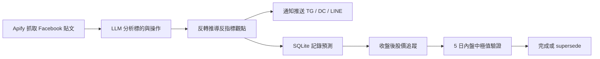

<p align="center">
  
</p>

<p align="center">
  繁體中文 | <a href="README.en.md">English</a>
</p>

<h1 align="center">banini-tracker</h1>

<p align="center">
  <strong>追蹤社群反指標名人的每一句話——AI 自動分析、即時推送、並用真實股價逐筆驗證。娛樂為主，數據為證。</strong>
</p>

<p align="center">
  <a href="https://www.npmjs.com/package/@cablate/banini-tracker"></a>
  <a href="https://github.com/cablate/banini-tracker/actions/workflows/ci.yml"></a>
  <a href="LICENSE"></a>
</p>

社群天天有人喊單，沒人驗證過反著做準不準。banini-tracker 追蹤「股海冥燈」巴逆逆（8zz）的 Facebook 社群貼文，透過 AI 辨識投資操作，再用真實股價追蹤反指標方向是否命中。

使用 Claude Opus 4.6 回溯分析 2024/04-2026/04 共 2,249 篇貼文，從中提取 345 筆明確的投資操作預測。

<p align="center">
  <strong>反指標勝率 68.6%（5 日內 ±1% 門檻，318 筆有效樣本）</strong>
</p>

<p align="center">
  
</p>

<p align="center">
  
</p>

## 它做什麼

1. 讀取巴逆逆貼文。
2. AI 辨識標的、她的操作與信心等級。
3. 反轉推導可能走勢。
4. 推送到 Telegram / Discord / LINE。
5. 連續 5 個交易日追蹤盤中最高/最低價，寫入 SQLite。

推送內容使用純文字欄位，對應目前分析輸出的 `symbolName`、`herAction`、`reverseView`、`confidence`、`reasoning`：

> 標的：台積電（2330）
>
> 她的操作：停損賣出
>
> 反指標：可能反彈 [高]
>
> 原因：停損賣出通常代表情緒低點，列入 5 日追蹤。

<!-- TODO: tg-report screenshot -->

## Quick Start

零金鑰先看公開資料集與回測摘要：

```bash
npx @cablate/banini-tracker demo
```

| 方式 | 指令 / 入口 | 適合情境 |
|---|---|---|
| Zeabur | [](https://zeabur.com/templates/ITT41M) | 雲端部署，首次進入 Web UI 建立管理員帳密 |
| Docker | `docker build -t banini-tracker .`<br>`docker run -d --name banini --env-file .env -v banini-data:/data -p 3000:3000 banini-tracker` | 自架常駐服務 |
| npx serve | `npx @cablate/banini-tracker serve`<br>`npx @cablate/banini-tracker serve --port 8080` | 本機快速啟動排程 + Web UI |
| 本地開發 | `cp .env.example .env`<br>`npm install && npm run start` | 修改原始碼 |

## How It Works



| 排程 | 時間 | 說明 |
|------|------|------|
| 早晨補漏 | 每天 08:00 | 抓前一晚的貼文（3 篇） |
| 盤中 | 週一~五 09:07-13:07 每 30 分 | 即時追蹤（1 篇） |
| 追蹤更新 | 週一~五 15:00 | 收盤後更新預測追蹤 |
| 盤後 | 每天 23:03 | 當日彙整（3 篇） |

## Claude Code Skill 專區

不想串 LLM API 時，可以把 [`skill/SKILL.md`](skill/SKILL.md) 加到你的 `.claude/skills/`。Claude Code 會直接使用該 skill 作為分析引擎，輸出可交給 CLI 推送的報告，不需要額外 LLM 費用。

## 判定方法論與透明度

公開資料集：[`data/banini-public.db`](data/banini-public.db)，SQLite 格式，不含原始貼文。

Schema 摘要：

| table | 說明 |
|---|---|
| `predictions` | 每筆貼文提取出的標的、她的操作、反向觀點、信心等級、基準價與追蹤狀態 |
| `price_snapshots` | 每筆預測後第 N 個交易日的 OHLC 與相對基準價漲跌幅 |

判定方式：每筆有效預測追蹤 5 個交易日內的盤中最高/最低價。`reverse_view='空'` 時，若最低跌幅達門檻即命中；`reverse_view='多'` 時，若最高漲幅達門檻即命中。

| 判定門檻（5 個交易日內盤中極值） | 命中 / 樣本 | 反指標勝率 |
|---|---:|---:|
| ±1%（現行宣告標準） | 218 / 318 | **68.6%** |
| ±3% | 134 / 318 | 42.1% |
| ±5% | 85 / 318 | 26.7% |

分方向：反向做多（她看空）48/64 = 75.0%；反向做空（她看多/買入）170/254 = 66.9%。

±1% 是寬鬆門檻，刻意用來衡量「短期反向波動是否出現」，不是要宣稱可直接套利。這個限制是可信度來源：門檻、樣本與資料庫都公開，讀者可以自行改門檻重算。

```bash
npm run stats
npm run stats -- --json
```

## 設定

### Web UI（Zeabur / Docker / npx serve）

常駐模式會在 port 3000 啟動設定頁面。首次進入建立管理員帳密，之後登入即可修改設定。修改後下次排程執行自動生效，不需重啟。

<p align="center">
  
</p>

### 環境變數（.env）

如果不使用 Web UI，也可以直接設定環境變數：

| 變數 | 必填 | 說明 |
|------|------|------|
| `APIFY_TOKEN` | 是 | Apify API token |
| `LLM_API_KEY` | 是 | LLM API key |
| `LLM_BASE_URL` | - | 預設 DeepInfra |
| `LLM_MODEL` | - | 預設 MiniMax-M2.5 |
| `TG_BOT_TOKEN` + `TG_CHANNEL_ID` | 至少一組 | Telegram 通知 |
| `DISCORD_BOT_TOKEN` + `DISCORD_CHANNEL_ID` | 至少一組 | Discord 通知 |
| `LINE_CHANNEL_ACCESS_TOKEN` + `LINE_TO` | 至少一組 | LINE 通知（Free plan 200 則/月） |
| `TRANSCRIBER` | - | `noop`（預設）或 `groq` |
| `GROQ_API_KEY` | - | Groq Whisper 影片轉錄用 |
| `FINMIND_TOKEN` | - | 股價查詢（免費可用） |

Web UI 和環境變數可以混用，Web UI 的設定優先。

## CLI 工具

不需 clone repo，搭配 Claude Code 等 AI 使用：

```bash
# 啟動常駐服務（排程 + Web UI）
npx @cablate/banini-tracker serve
npx @cablate/banini-tracker serve --persona ./personas/banini.json

# 初始化 CLI 設定
npx @cablate/banini-tracker init --apify-token YOUR_TOKEN

# 抓取貼文
npx @cablate/banini-tracker fetch -n 3 --mark-seen

# 推送到 Telegram
npx @cablate/banini-tracker push -f report.txt
```

完整指令說明見：

```bash
npx @cablate/banini-tracker --help
```

## 費用估算

| 項目 | 月估算 |
|------|--------|
| Facebook 抓取（Apify） | ~$1.35（~270 篇） |
| LLM 分析 | 依模型定價 |
| 通知推送（TG / DC） | 免費 |
| LINE 推送 | Free plan 200 則/月 |
| 股價查詢（FinMind） | 免費 |

CLI 模式搭配 Claude Code 不需 LLM 費用，Claude 自己分析。

## FAQ

### 會不會被 Facebook 擋？

抓取透過 Apify 執行，仍可能受 Facebook 介面、登入狀態、頻率限制或目標社群權限影響。建議低頻排程、保留錯誤通知，並把本專案視為娛樂資料工具，不保證來源永遠可抓。

### 她刪文或退燒怎麼辦？

已記錄的預測與價格快照仍保留在 SQLite。若未來貼文量下降，Roadmap 的 persona 設定檔會讓同一套流程可追蹤其他公開人物或社群來源。

### 可以追蹤別人嗎？

目前預設目標是巴逆逆（8zz）。persona 化已列入本次 Roadmap，目標是把 prompt、抓取目標與追蹤參數抽成 JSON 設定檔。

### 勝率為什麼用盤中極值，不用收盤價？

這個專案衡量的是貼文後 5 個交易日內是否出現反向波動。盤中極值比收盤價更能捕捉短線反指標效果，但也比較寬鬆，所以 README 同時公開 ±1% / ±3% / ±5% 三檔結果。

### 這是投資建議嗎？

不是。本專案僅供娛樂、資料分析與工程展示，不構成任何投資建議。

## Roadmap

| 狀態 | 方向 | 說明 |
|---|---|---|
| 進行中 | demo 模式 | 零金鑰執行 `npx @cablate/banini-tracker demo`，直接讀公開資料集看結果 |
| 已完成 | persona 設定檔 | 把目標、prompt、追蹤天數與門檻抽成 JSON，支援追蹤其他人物 |
| 進行中 | 每週自動戰報 | 產出可分享的 SVG / Markdown 戰報 |
| 進行中 | 多來源 adapter | Threads / PTT / YouTube 留言，基於 source adapter 介面擴充 |
| 長期 | personas/ 社群模板庫 | 接受 PR，類似 n8n templates 模式 |
| 長期 | GitHub Pages 唯讀 dashboard | 用 sql.js 讀公開 db，做靜態勝率看板 |
| 長期 | Hosted SaaS | AGPL 下維護者保有商業部署權；「不想自己部署」是最大客群 |
| 長期 | 資料 API / 訂閱戰報 | 公開資料集的商業化出口 |

## 免責聲明

本專案僅供娛樂參考，不構成任何投資建議。

## License

> **AGPL-3.0** — 使用、修改或部署本專案，必須標明原作者 **[cablate](https://github.com/cablate)**、附上[本 repo 連結](https://github.com/cablate/banini-tracker)，並以相同授權公開原始碼。網路服務部署亦同。
>
> 本專案於 2026/04/13 從 MIT 切換至 AGPL-3.0。此日期之前取得的版本仍適用 MIT 授權。

[AGPL-3.0](LICENSE)

## Star History

<a href="https://star-history.com/#cablate/banini-tracker&Date">
 <picture>
   <source media="(prefers-color-scheme: dark)" srcset="https://api.star-history.com/svg?repos=cablate/banini-tracker&type=Date&theme=dark" />
   <source media="(prefers-color-scheme: light)" srcset="https://api.star-history.com/svg?repos=cablate/banini-tracker&type=Date" />
   
 </picture>
</a>
